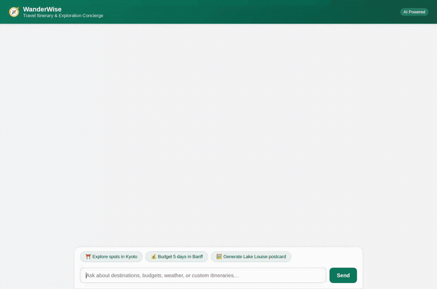

# WanderWise — Travel Itinerary & Exploration Concierge

WanderWise is an AI travel concierge and itinerary planner built with the Google Agent Development Kit (ADK) and powered by `gemini-3.6-flash`. It integrates long-term user memory, database lookups, real-world Google Maps geocoding and place searches, budgeting tools, image/video generation, and secure sandboxed code execution, rendering all recommendations as structured A2UI cards.



---

## What the Agent Actually Does

WanderWise implements the following capabilities wired to real Google Cloud services and ADK tools:

### 1. Long-Term Memory (Vertex AI Memory Bank)
- Cross-session memory powered by `PreloadMemoryTool` and an `after_agent_callback` (`generate_memories_callback`).
- Automatically extracts and persists traveler preferences across sessions: budget level, preferred pacing, travel vibes, dietary requirements, and crucial medical/food allergies.
- Never suggests activities or restaurants that conflict with known traveler allergies.

### 2. Curated Destination Catalog (Google Cloud Firestore)
- Backed by Google Cloud Firestore (`travel_destinations` collection).
- `list_destinations(city, category)`: Queries destinations across cities like Kyoto, Rome, Banff, Paris, and Reykjavik with rich attributes (highlights, estimated cost, recommended duration).
- `add_destination(...)`: Dynamically registers new travel spots into the shared Firestore catalog.

### 3. Location & Navigation (Google Maps & Places API)
- `geocode_address(address)`: Converts any landmark, address, or neighborhood into latitude/longitude coordinates via the Google Maps Geocoding API.
- `find_nearby_places(latitude, longitude, place_type, keyword, radius_meters)`: Finds nearby restaurants, cafes, attractions, or museums using the Google Places API.

### 4. Travel Budgeting & Utilities
- `calculate_trip_budget(destination, days, travelers, accommodation_tier, include_flights)`: Generates detailed cost estimates broken down by lodging, dining, activities, and transit.
- `get_currency_exchange_rates(base_currency)`: Fetches conversion benchmarks across major currencies (USD, EUR, JPY, GBP, CAD, CHF, AUD).
- `get_weather(query)` and `get_current_time(query)`: Checks local conditions and time zone offsets.

### 5. Media Generation (Google GenAI & Cloud Storage)
- **Scenic Postcard Generation (`generate_destination_image`)**: Generates high-resolution destination images with `imagen-3.0-generate-002`, saves them as session artifacts for the Playground, and uploads the image bytes directly to a public Google Cloud Storage bucket.
- **Short Video Generation (`generate_destination_video`)**: Generates short cinematic video clips using Google's Omni model (`gemini-omni-flash-preview`), saves the artifact in the session, and uploads to Google Cloud Storage.

### 6. Sandboxed Code Execution (Agent Engine Sandbox)
- Integrated with `AgentEngineSandboxCodeExecutor`.
- Safely runs generated Python code in an isolated Google Cloud sandbox environment for complex mathematical operations, date and schedule planning, or custom budget modeling.

### 7. Structured UI (A2UI) & Dialogue Frontend
- Equipped with `A2uiSchemaManager` (BasicCatalog 0.8) and `a2ui_callback` to format responses into clean, flat UI cards and columns.
- Communicates over the Agent-to-Agent (A2A) protocol.
- Includes a dialogue chat interface with conversation history and quick-start prompt pills.

---

## Planned / Not Yet Implemented Features
The following ideas from the initial project brief were not implemented in this phase:
- *Multi-day scheduling time-allocation optimizer tool* (handled by general LLM reasoning and code sandbox rather than a dedicated specialized tool).
- *Cloud Trace observability dashboard configuration* (not configured in this deployment).

---

## Project Structure

```
.
├── agents-cli-manifest.yaml   # Agent Engine configuration and deployment metadata
├── app/
│   ├── __init__.py            # App export
│   ├── agent.py               # Root agent, tools, Firestore, Maps, Storage & Memory setup
│   └── a2ui_utils.py          # A2UI model callback formatting
├── docs/
│   └── demo.gif               # Looping demo recording
├── frontend/
│   ├── main.py                # FastAPI proxy connecting browser to agent via A2A
│   ├── requirements.txt       # Frontend dependencies
│   ├── Dockerfile             # Container configuration for Cloud Run
│   └── static/
│       └── index.html         # Branded WanderWise chat UI with A2UI renderer
└── pyproject.toml             # Python package definition & ADK dependencies
```

---

## Local Setup & Run Instructions

### Prerequisites
- Python 3.11+
- `uv` or `pip`
- Google Cloud CLI (`gcloud`) authenticated to your GCP project:
  ```bash
  gcloud auth application-default login
  ```

### 1. Install Dependencies
In the root directory of the repository:
```bash
uv sync
```
Or with standard pip:
```bash
pip install -e .
```

### 2. Run the Agent Locally via ADK Web
To test the agent with the ADK developer UI:
```bash
adk web app
```

### 3. Run the Custom Frontend Locally
Navigate to the `frontend/` directory and install its requirements:
```bash
cd frontend
pip install -r requirements.txt
```

Set the required environment variables and start the server:
```bash
export AGENT_ENGINE_RESOURCE_NAME="<YOUR_AGENT_ENGINE_RESOURCE_NAME>"
export AGENT_DIRECTORY="app"
export PORT=8080

python3 main.py
```
Open your browser and navigate to the local server port to chat with WanderWise.
